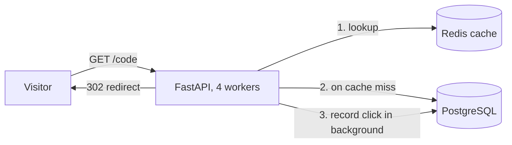

# URL Shortener


A URL shortening service with click analytics, built with FastAPI, PostgreSQL, and Redis. It creates short links, redirects visitors, records every click (device, referrer, country), caches hot links in Redis, rate limits link creation, and exposes an analytics API.

## Features

- Create short links with cryptographically secure, collision-safe codes
- 302 redirects with a Redis cache in front of PostgreSQL
- Click tracking: device, referrer, country, timestamp
- Per-link analytics: totals, by device, by country, last 7 days
- Redis-based rate limiting (429 Too Many Requests)
- Paginated link listing
- Alembic database migrations
- Dockerized, with automated tests and CI

## Architecture



**Redirect flow:** check Redis first. On a miss, read PostgreSQL and fill the cache (1 hour TTL). The click is recorded after the response is sent, so the visitor never waits for analytics.

## Tech stack

Python 3.12, FastAPI, SQLAlchemy 2, Alembic, PostgreSQL 16, Redis 7, Docker Compose, pytest, Locust, GitHub Actions.

## Run it

```bash
git clone https://github.com/codewith-payal/url-shortener.git
cd url-shortener
docker compose up --build
```

Open http://localhost:8000/docs for the interactive API docs (Swagger). Migrations run automatically when the app container starts.

## API

| Method | Path | Description |
|---|---|---|
| POST | `/shorten` | Create a short link. Rate limited to 5 requests per minute per IP. |
| GET | `/{code}` | Redirect (302) to the original URL and record a click. |
| GET | `/links?limit=20&offset=0` | Paginated list of links, newest first. |
| GET | `/links/{code}/stats` | Analytics for one link. |
| GET | `/health` | Health check. |

## Design decisions and trade-offs

- **302, not 301.** A 301 is cached by browsers, so repeat visits would never reach the server and could not be counted.
- **Collision handling relies on the database.** Codes are 7 random characters from a 62-character alphabet. Instead of "check if it exists, then insert" (which two concurrent requests can both pass), the insert is attempted and the `UNIQUE` constraint rejects duplicates, followed by a retry.
- **Cache-aside with a TTL.** Redis stores the link's id and URL for one hour. The id is cached too, because recording a click needs it. Trade-off: if a link were edited, the old URL could be served until the TTL expires. Link editing does not exist yet, so invalidation is not implemented.
- **Rate limiting with Redis `INCR` + `EXPIRE NX`** in one pipeline. Redis is shared by all workers, so limits stay correct with several processes. Trade-off: a fixed window allows a short burst at a window boundary.
- **Clicks are written in a background task.** This removes the database write from the visitor's latency. Trade-off: a click can be lost if the process crashes right after responding. A durable job queue would fix that.
- **Index on `clicks.link_id`.** With about 200,000 rows, fetching one link's clicks took 0.6 ms with the index and 19 ms without it (a sequential scan), measured with `EXPLAIN ANALYZE`.
- **Offset pagination.** Simple and fine at this size. At very large sizes, keyset pagination would be faster, since offset has to skip rows.
- **Country comes from the `CF-IPCountry` header**, which is only present behind Cloudflare. It is empty when running locally. Device detection is a simple User-Agent heuristic.

## Performance

Measured with Locust: 100 concurrent users for 30 seconds, hitting redirects (90% of traffic on 10 hot links), 4 uvicorn workers, in Docker.

| Setup | Requests/sec | p95 latency | Failures |
|---|---|---|---|
| 1 worker, click written before responding | 179 | 720 ms | 0 |
| 4 workers, click written in background | **353** | **250 ms** | **0** |

Caveat: everything (Locust, 4 workers, PostgreSQL, Redis) ran on one laptop, and Locust reported its own CPU above 90%. A dedicated server would do better, so these numbers are conservative. Reproduce with:

```bash
pip install -r loadtest/requirements.txt
locust -f loadtest/locustfile.py --host http://127.0.0.1:8000 --headless -u 100 -r 20 -t 30s --only-summary
```

## Tests

The tests run against a separate `shortener_test` database and a separate Redis database, so they never touch development data.

```bash
docker compose up -d db redis
docker compose exec db psql -U shortener -c "CREATE DATABASE shortener_test;"
pip install -r requirements.txt
pytest -v
```

They cover creating links, validation, redirects, 404s, caching (HIT/MISS), rate limiting, click recording, and pagination. CI runs them on every push.

## Project structure

```
app/            FastAPI app (main, models, database, cache, ratelimit, utils)
alembic/        database migrations
tests/          pytest suite and shared fixtures
loadtest/       Locust load test
Dockerfile      app image
docker-compose.yml   app + PostgreSQL + Redis
```

## Known limitations and next steps

- No authentication, and links cannot be edited or deleted yet
- Not-found codes are not cached
- Click recording is not durable if the process crashes (a job queue would fix this)
- No custom short codes or link expiry